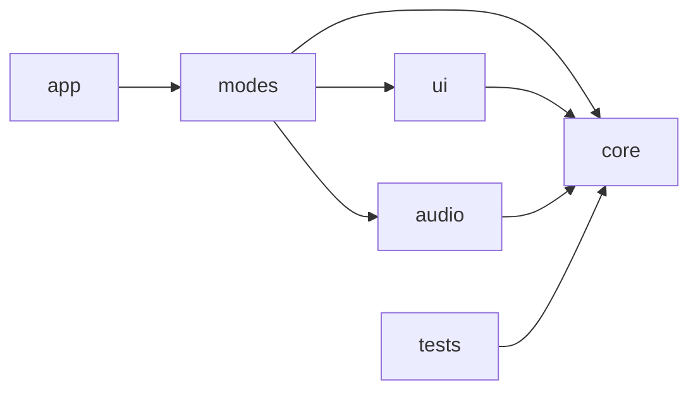
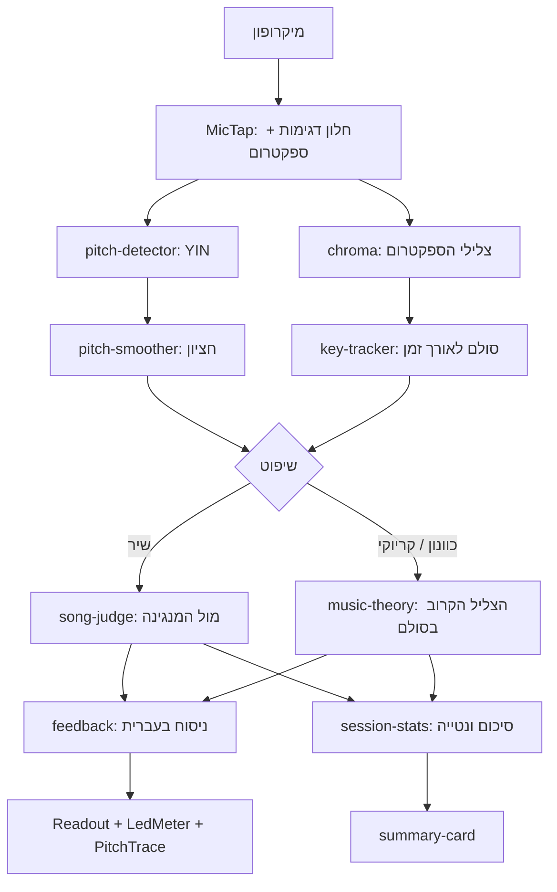

# עיצוב הקוד

מסמך זה מסביר איך האפליקציה בנויה, למה, ואיך מרחיבים אותה. הוא נכתב כדי שמי שיפתח את הקוד בעוד חצי שנה
(כולל אני) ידע איפה לגעת ומה לא לשבור.

## עקרונות

1. **ליבה טהורה.** כל הלוגיקה החשובה (זיהוי צליל, סולמות, מעקב סולם, שיפוט, ניסוח משוב, הגדרות) נמצאת ב־`src/core`
   ולא נוגעת ב־DOM או ב־Web Audio. לכן אפשר להריץ אותה ב־Node ולבדוק אותה על שמע מסונתז, בלי דפדפן.
2. **תלות בכיוון אחד.** `core` ← `audio` ← `ui` ← `modes` ← `app`. שכבה לא מייבאת משכבה שמעליה.
3. **מצבים הם תוספים.** כל מצב (כוונון, שיר, קריוקי) הוא מודול שמחזיר `{id, title, icon, mount, unmount}`.
   המעטפת (`app.js`) לא יודעת עליהם כלום חוץ מהרשימה.
4. **תלויות מוזרקות.** `createSettings(storage)` מקבל את האחסון מבחוץ, ולכן נבדק בלי `localStorage`.
5. **מקום אחד לכל דבר.** כל הטקסטים שהמשתמש רואה על שיפוט נמצאים ב־`feedback.js`. כל הקבועים הקסומים הם
   קבועים עם שם בראש הקובץ שלהם.
6. **בדיקות עם שיניים.** לכל התנהגות חשובה יש בדיקת "ביקורת" שמוכיחה שהבדיקה מסוגלת להיכשל (למשל: אותו תרחיש בלי
   סינון קול, או עם סולם קפוא).

## מבנה התיקיות

```
index.html            מעטפת: כותרת, אזור תצוגה, ניווט תחתון
css/app.css           כל העיצוב, מבוסס טוקנים (בהיר וכהה)
src/
  app.js              רישום מצבים, ניווט לפי hash, service worker
  core/               לוגיקה טהורה, נבדקת ב-Node
  audio/              כל מה שנוגע ב-Web Audio וב-API של המכשיר
  ui/                 רכיבי תצוגה ובקרה לשימוש חוזר
  modes/              שלושת המצבים, כל אחד קובץ אחד
tests/                בדיקות (node --test), כולל מסנתז שמע
docs/                 המסמכים האלה
```

## תרשים תלויות



## זרימת הנתונים



## המודולים

| מודול | אחריות |
|---|---|
| `core/music-theory` | שמות צלילים, סולמות, `nearestScaleNote`, `compareToTarget`, `keyMask` |
| `core/pitch-detector` | YIN: חלון דגימות ← `{freq, clarity}` או `null` |
| `core/pitch-smoother` | מייצב את הגובה: חציון בחלון זמן, ממוצע רץ, זיהוי החלפת תו, ושכחה אחרי שקט |
| `core/hysteresis` | `ScaleNoteLatch` ו־`ToleranceLatch`: מונעים הבהוב כשערך מרחף ליד גבול החלטה |
| `core/scale-judge` | צליל יעד בסולם + בול/גבוה/נמוך, עם היסטרזיס. משותף לכוונון ולקריוקי |
| `core/chroma` | ספקטרום ← וקטור של 12 צלילים, אפשר למחוק את ההרמוניות של הזמר |
| `core/key-estimation` | פרופילי Krumhansl-Schmuckler: וקטור ← סולם |
| `core/key-tracker` | סולם לאורך זמן, כולל שינוי סולם באמצע שיר: צבירת ראיות (CUSUM), נבדק 10 פעמים בשנייה |
| `core/external-session` | קריוקי מרמקול: קול מעל מוזיקה, ומעקב סולם, בלי תלות בדפדפן |
| `core/song-timeline`, `songs` | שיר ← ציר זמן בשניות |
| `core/song-judge` | שיפוט מול מנגינה, שלושה מצבי התאמה: מדויק, כל אוקטבה, בקול שלי. היסטרזיס על הסבילות, מתאפס בכל תו |
| `core/session-stats`, `feedback` | סטטיסטיקה, נטייה (גבוה/נמוך), וכל הניסוחים |
| `core/settings` | העדפות (קפדנות, תגובת המדד, ועוד) עם ולידציה, שמירה והרשמה לשינויים |
| `core/mic-help` | הסבר בעברית לחסימת מיקרופון לפי דפדפן ומכשיר |
| `audio/microphone`, `mic-tap` | פתיחת מיקרופון, הסברי שגיאה, קריאת דגימות וספקטרום |
| `audio/backing-synth` | ליווי וספירה לאחור על שעון האודיו |
| `ui/listening-session` | מחזור החיים המשותף: מיקרופון, מסך דולק, לולאת פריימים, ניקוי |
| `ui/readout`, `led-meter`, `pitch-trace`, `piano-roll` | רכיבי התצוגה |

## יציבות: למה המדד לא קופץ

קול אנושי לא יציב: ויברטו (5–6 פעמים בשנייה, בדרך כלל ±30 עד ±50 סנט) ורעידות אקראיות קטנות. מדד שעוקב
אחרי כל פריים נראה "עצבני". הפתרון הוא שלושה שלבים, וכל אחד מטפל בבעיה אחרת:

1. **`PitchSmoother`: מה הגובה האמיתי.**
   חציון בחלון של 0.15 שנייה (ארוך ממחצית מחזור ויברטו, ולכן הרעידה מתמצעת והקפיצות החד־פריימיות נעלמות),
   ואחריו ממוצע רץ: בתחילת תו זה ממוצע מצטבר (מתכנס לגובה האמיתי תוך כחצי שנייה), ואחר כך פילטר אקספוננציאלי איטי
   (קבוע זמן 0.5 שנייה כברירת מחדל, וניתן לשינוי בהגדרות). כדי שהמדד לא יתעכב אחרי תו חדש, יש זיהוי החלפת תו:
   אם החציון רחוק מעל חצי חצי טון יותר מ־0.05 שנייה, מקבלים את הערך החדש מיד.
2. **`ScaleNoteLatch`: מול איזה צליל משווים.**
   בלי זה, גובה שמרחף באמצע בין שני צלילים גורם לצליל היעד להתחלף (והסטייה לקפוץ מ־+50 ל־‎־50) בכל פריים.
   עכשיו מחליפים צליל יעד רק כשצליל אחר קרוב יותר ב־20 סנט לפחות.
3. **`ToleranceLatch`: "בול" או לא.**
   נכנסים ל"בול" ב־35 סנט, אבל יוצאים ממנו רק מעל 43. כך גובה ששוהה ליד הגבול לא מהבהב.

נמדד (אותו קול רועד, בדפדפן, 6 שניות): תזוזות נורה 140 ← 20, קפיצה גדולה בין פריימים 49 ← 2 סנט,
החלפות שם צליל ליד אמצע 65 ← 0, והיפוכי "בול/לא בול" ליד הגבול 89 ← 0.

המחיר: מדד רגוע מפגר אחרי החלקה (גליסנדו) בערך שיפוע כפול קבוע הזמן (0.4 חצאי טון בשנייה: כ־25 סנט). החלקות
מהירות נתפסות בזכות זיהוי החלפת התו, והפיגור מוגבל. מי שמעדיף מדד "ישיר" יכול לבחור "מהיר" בהגדרות.

## זיהוי סולם: למה צוברים ראיות

`KeyTracker` מחשב בכל 0.1 שנייה (פי 10 מקודם) כמה הסולם הנוכחי מתאים לשמע האחרון, ומה הסולם שמתאים הכי טוב.
הוא לא סופר "כמה בדיקות רצופות" אלא **צובר ראיות** (CUSUM): בכל בדיקה מוסיפים (כמה הסולם החדש עדיף על הנוכחי
פחות סף של 0.15) כפול הזמן שעבר, ומחליפים כשהסכום מגיע ל־0.4 והחלון המהיר מסכים.

למה לא ספירה? בגרסה הראשונה (3 בדיקות רצופות) התוצאה התבררה כתלויה בקצב הדגימה: אותו שיר החליף סולם בקצב דגימה
אחד ולא באחר, כי צניחה קצרה אחת בראיות מאפסת ספירה, והאם הבדיקה פגעה בצניחה היה מקרה. צבירה לא רגישה לזה:
צניחה רק מאטה, ולא מאפסת. הבדיקות מוודאות עכשיו שאין תלות כזאת (קצבי דגימה 0.05 עד 0.2 שנייה).

נמדד על 8 סוגי מעברי סולם ועל 5 וריאציות של תיבה זרה: השהיה ממוצעת כ־9.5 שניות (5.5 עד 13.6), לעומת כ־13.8
(עד 21) קודם, ואפס החלפות שווא ב־40 ריצות. חלון קצר יותר (3.5 שניות) מגיב כבר אחרי כ־6.5 שניות, אבל החליף סולם
בטעות ב־8 עד 12 מתוך 40 ריצות, ולכן לא נבחר.

## איך מרחיבים

**מצב חדש.** כותבים `src/modes/my-mode.js` שמחזיר `{id, title, icon, mount(host), unmount()}`, מוסיפים את
הפונקציה ל־`MODE_FACTORIES` ב־`app.js`, ואת הקבצים ל־`sw.js`. כל השאר (ניווט, ניתוב) נבנה לבד.
בתוך המצב משתמשים ב־`ListeningSession` ובמה שצריך מ־`ui`.

**שיר חדש.** מוסיפים ערך ל־`src/core/songs.js`. יש בדיקה שמוודאת שהשיר תקין (תווים לא חופפים, אקורדים עד הסוף).

**סולם חדש** (פנטטוני, דוריאן וכו'). מוסיפים ערך ל־`SCALES` ב־`music-theory.js`. אם רוצים שגם הזיהוי האוטומטי
יכיר אותו, מוסיפים לו פרופיל ב־`key-estimation.js`.

**מזהה צליל אחר** (pYIN, CREPE, SwiftF0). החוזה הוא פונקציה `(samples, sampleRate, options) => {freq, clarity} | null`.
מחליפים את `detectPitch` ב־`ExternalSession` ובמצבים, ובדיקות `tests/pitch.test.js` ו־`tests/key.test.js` יגידו אם זה טוב יותר.

**כלל ניקוד חדש.** מוסיפים מחלקה ליד `SongJudge` שמחזירה את אותם `verdict`ים. `feedback.js` וסיכום הסשן יעבדו בלי שינוי.

**ניסוח אחר.** משנים רק את `feedback.js`. הבדיקות ב־`modules.test.js` בודקות כיוון (גבוה/נמוך, רדו/עלו), לא מילים מדויקות.

## אסטרטגיית בדיקות

* `tests/helpers.js` מסנתז שמע: אקורדים עם הרמוניות, בס, תופים, שירה עם ויברטו, רעש. הוא גם מחשב FFT
  בדיוק כמו `AnalyserNode`, כך שהבדיקות עוברות בצינור המלא ולא על נתונים מוכנים.
* `key.test.js`: זיהוי סולם (24 סולמות, שלושה קצבי דגימה, כיוון שגוי, רעש), שינויי סולם, תיבות זרות, שקט, שירה מעל ליווי.
* `pitch.test.js`: YIN במקרי קצה (ויברטו, חיתוך, DC, בסיס חסר, רעש, מאגר קצר).
* `theory.test.js`, `modules.test.js`: תאוריה, שיפוט, סטטיסטיקה, ניסוח, הגדרות, מצב "בקול שלי".
* מגבלות ידועות מסומנות `todo`: הן ממשיכות לרוץ ומופיעות בדוח, אבל לא מפילות את הסוויטה.

## החלטות ופשרות

* **מהירות מול יציבות בזיהוי שינוי סולם.** חלון קצר מגיב מהר אבל מתבלבל מאקורד זר. חלון ארוך יציב אבל מאחר.
  הערכים נבחרו לפי סריקה על נתונים (ממוצע 9.5 שניות, ראו "זיהוי סולם" למעלה). הדרך לשפר את שניהם היא מודל סטטיסטי
  (HMM), ראו `ROADMAP.md`.
* **ממוצע ולא ספירה.** גם בחלון וגם בהחלטה על שינוי סולם, כל מה שנקבע לפי "N פריימים רצופים" התגלה כשביר: הוא תלוי
  בקצב הדגימה ובמקרה. ממוצעים וצבירה לאורך זמן יציבים הרבה יותר.
* **YIN ולא רשת נוירונים.** YIN קטן, מהיר, ואין לו קבצי מודל. בתנאים רגילים הוא מספיק. רשת כמו CREPE
  מדויקת יותר בליווי צפוף, במחיר של מאות KB ועומס על המכשיר.
* **ESM בלי כלי בנייה.** הקוד רץ כמו שהוא בדפדפן וב־Node. אין `npm install`, אין bundler, ואפשר לפרוס על GitHub Pages כמות שהוא.
* **ה־service worker הוא "רשת קודם".** כך עדכונים מופיעים מיד, ורק בלי אינטרנט נטען המטמון.

## עיצוב ויזואלי

המראה הוא פאנל של מכשיר כוונון: אפור־כחלחל, דיו כהה, ונורות LED שמראות את המצב.
הבחירות נעשו בכוונה, כדי שהאפליקציה לא תיראה כמו עוד תבנית:

* **סרגל נורות ולא פס גרדיאנט.** אותו מידע (כמה גבוה או נמוך), אבל בצורה שהמוזיקאים מכירים מפדלי כוונון.
* **אין אימוג'י ואין גרדיאנט סגול.** סמלים הם קווים דקים ב־SVG, והצבע משמש רק למצב: ירוק בול, כתום גבוה, כחול נמוך, צהוב אוקטבה.
* **הפעולה הראשית בולטת, ההגדרות מתקפלות.** כפתור אחד גדול, והכול השאר מתחת.
* **ניסוח אנושי.** "בול", "גבוה קצת, רדו מעט", במקום "מדויק! ✓".
* **טוקנים.** כל הצבעים והגופנים הם משתני CSS בראש `css/app.css`, בהיר וכהה, ושינוי מראה הוא שינוי במקום אחד.
  הקנבסים (גרף היסטוריה, גלילת צלילים) קוראים את הצבעים מאותם משתנים, ולכן עוקבים אחרי ערכת הנושא.
* **גופנים:** Assistant לטקסט ו־Secular One לשם הצליל הגדול (עם גופן מערכת כגיבוי).
