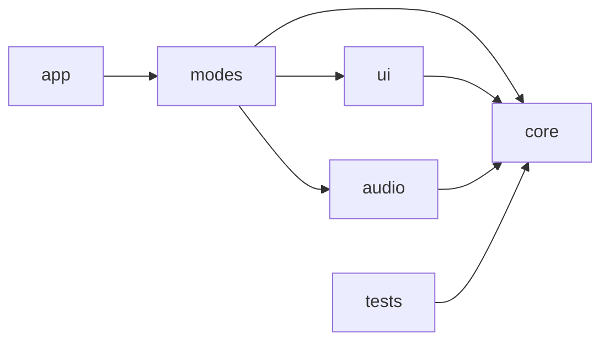
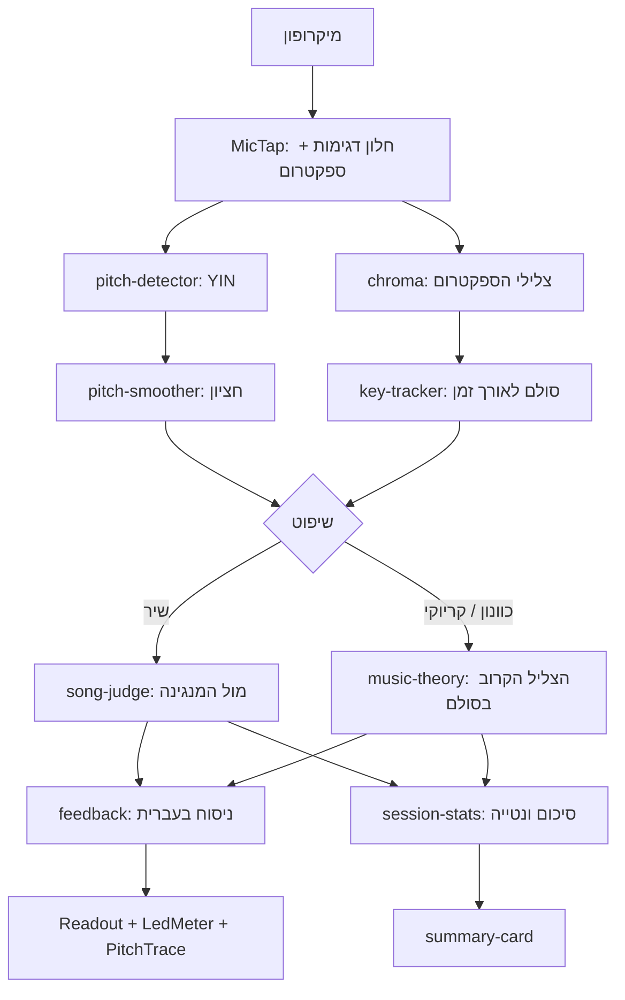

# עיצוב הקוד

מסמך זה מסביר איך האפליקציה בנויה, למה, ואיך מרחיבים אותה. הוא נכתב כדי שמי שיפתח את הקוד בעוד חצי שנה
(כולל אני) ידע איפה לגעת ומה לא לשבור.

## עקרונות

1. **ליבה טהורה.** כל הלוגיקה החשובה (זיהוי צליל, סולמות, מעקב סולם, שיפוט, ניסוח משוב, הגדרות) נמצאת ב־`src/core`
   ולא נוגעת ב־DOM או ב־Web Audio. לכן אפשר להריץ אותה ב־Node ולבדוק אותה על שמע מסונתז, בלי דפדפן.
2. **תלות בכיוון אחד.** `core` ← `audio` ← `ui` ← `modes` ← `app`. שכבה לא מייבאת משכבה שמעליה.
3. **מצבים הם תוספים.** כל מצב (כוונון, שיר, קריוקי) הוא מודול שמחזיר `{id, title, icon, mount, unmount}`.
   המעטפת (`app.js`) לא יודעת עליהם כלום חוץ מהרשימה.
4. **תלויות מוזרקות.** `createSettings(storage)` מקבל את האחסון מבחוץ, ולכן נבדק בלי `localStorage`.
5. **מקום אחד לכל דבר.** כל הטקסטים שהמשתמש רואה על שיפוט נמצאים ב־`feedback.js`. כל הקבועים הקסומים הם
   קבועים עם שם בראש הקובץ שלהם.
6. **בדיקות עם שיניים.** לכל התנהגות חשובה יש בדיקת "ביקורת" שמוכיחה שהבדיקה מסוגלת להיכשל (למשל: אותו תרחיש בלי
   סינון קול, או עם סולם קפוא).

## מבנה התיקיות

```
index.html            מעטפת: כותרת, אזור תצוגה, ניווט תחתון
css/app.css           כל העיצוב, מבוסס טוקנים (בהיר וכהה)
src/
  app.js              רישום מצבים, ניווט לפי hash, service worker
  core/               לוגיקה טהורה, נבדקת ב-Node
  audio/              כל מה שנוגע ב-Web Audio וב-API של המכשיר
  ui/                 רכיבי תצוגה ובקרה לשימוש חוזר
  modes/              שלושת המצבים, כל אחד קובץ אחד
tests/                בדיקות (node --test), כולל מסנתז שמע
docs/                 המסמכים האלה
```

## תרשים תלויות



## זרימת הנתונים



## המודולים

| מודול | אחריות |
|---|---|
| `core/music-theory` | שמות צלילים, סולמות, `nearestScaleNote`, `compareToTarget`, `keyMask` |
| `core/pitch-detector` | YIN: חלון דגימות ← `{freq, clarity}` או `null` |
| `core/pitch-smoother` | חציון על כמה קריאות אחרונות, ושכחה אחרי שקט |
| `core/chroma` | ספקטרום ← וקטור של 12 צלילים, אפשר למחוק את ההרמוניות של הזמר |
| `core/key-estimation` | פרופילי Krumhansl-Schmuckler: וקטור ← סולם |
| `core/key-tracker` | סולם לאורך זמן, כולל שינוי סולם באמצע שיר, עם היסטרזיס |
| `core/external-session` | קריוקי מרמקול: קול מעל מוזיקה, ומעקב סולם, בלי תלות בדפדפן |
| `core/song-timeline`, `songs` | שיר ← ציר זמן בשניות |
| `core/song-judge` | שיפוט מול מנגינה, שלושה מצבי התאמה: מדויק, כל אוקטבה, בקול שלי |
| `core/session-stats`, `feedback` | סטטיסטיקה, נטייה (גבוה/נמוך), וכל הניסוחים |
| `core/settings` | העדפות עם ולידציה, שמירה והרשמה לשינויים |
| `audio/microphone`, `mic-tap` | פתיחת מיקרופון, הסברי שגיאה, קריאת דגימות וספקטרום |
| `audio/backing-synth` | ליווי וספירה לאחור על שעון האודיו |
| `ui/listening-session` | מחזור החיים המשותף: מיקרופון, מסך דולק, לולאת פריימים, ניקוי |
| `ui/readout`, `led-meter`, `pitch-trace`, `piano-roll` | רכיבי התצוגה |

## איך מרחיבים

**מצב חדש.** כותבים `src/modes/my-mode.js` שמחזיר `{id, title, icon, mount(host), unmount()}`, מוסיפים את
הפונקציה ל־`MODE_FACTORIES` ב־`app.js`, ואת הקבצים ל־`sw.js`. כל השאר (ניווט, ניתוב) נבנה לבד.
בתוך המצב משתמשים ב־`ListeningSession` ובמה שצריך מ־`ui`.

**שיר חדש.** מוסיפים ערך ל־`src/core/songs.js`. יש בדיקה שמוודאת שהשיר תקין (תווים לא חופפים, אקורדים עד הסוף).

**סולם חדש** (פנטטוני, דוריאן וכו'). מוסיפים ערך ל־`SCALES` ב־`music-theory.js`. אם רוצים שגם הזיהוי האוטומטי
יכיר אותו, מוסיפים לו פרופיל ב־`key-estimation.js`.

**מזהה צליל אחר** (pYIN, CREPE, SwiftF0). החוזה הוא פונקציה `(samples, sampleRate, options) => {freq, clarity} | null`.
מחליפים את `detectPitch` ב־`ExternalSession` ובמצבים, ובדיקות `tests/pitch.test.js` ו־`tests/key.test.js` יגידו אם זה טוב יותר.

**כלל ניקוד חדש.** מוסיפים מחלקה ליד `SongJudge` שמחזירה את אותם `verdict`ים. `feedback.js` וסיכום הסשן יעבדו בלי שינוי.

**ניסוח אחר.** משנים רק את `feedback.js`. הבדיקות ב־`modules.test.js` בודקות כיוון (גבוה/נמוך, רדו/עלו), לא מילים מדויקות.

## אסטרטגיית בדיקות

* `tests/helpers.js` מסנתז שמע: אקורדים עם הרמוניות, בס, תופים, שירה עם ויברטו, רעש. הוא גם מחשב FFT
  בדיוק כמו `AnalyserNode`, כך שהבדיקות עוברות בצינור המלא ולא על נתונים מוכנים.
* `key.test.js`: זיהוי סולם (24 סולמות, שלושה קצבי דגימה, כיוון שגוי, רעש), שינויי סולם, תיבות זרות, שקט, שירה מעל ליווי.
* `pitch.test.js`: YIN במקרי קצה (ויברטו, חיתוך, DC, בסיס חסר, רעש, מאגר קצר).
* `theory.test.js`, `modules.test.js`: תאוריה, שיפוט, סטטיסטיקה, ניסוח, הגדרות, מצב "בקול שלי".
* מגבלות ידועות מסומנות `todo`: הן ממשיכות לרוץ ומופיעות בדוח, אבל לא מפילות את הסוויטה.

## החלטות ופשרות

* **מהירות מול יציבות בזיהוי שינוי סולם.** חלון קצר מגיב מהר אבל מתבלבל מאקורד זר. חלון ארוך יציב אבל מאחר.
  הערכים נבחרו לפי סריקה על נתונים (7 עד 15 שניות, ראו `key-tracker.js`). הדרך לשפר את שניהם היא מודל סטטיסטי
  (HMM), ראו `ROADMAP.md`.
* **YIN ולא רשת נוירונים.** YIN קטן, מהיר, ואין לו קבצי מודל. בתנאים רגילים הוא מספיק. רשת כמו CREPE
  מדויקת יותר בליווי צפוף, במחיר של מאות KB ועומס על המכשיר.
* **ESM בלי כלי בנייה.** הקוד רץ כמו שהוא בדפדפן וב־Node. אין `npm install`, אין bundler, ואפשר לפרוס על GitHub Pages כמות שהוא.
* **ה־service worker הוא "רשת קודם".** כך עדכונים מופיעים מיד, ורק בלי אינטרנט נטען המטמון.

## עיצוב ויזואלי

המראה הוא פאנל של מכשיר כוונון: אפור־כחלחל, דיו כהה, ונורות LED שמראות את המצב.
הבחירות נעשו בכוונה, כדי שהאפליקציה לא תיראה כמו עוד תבנית:

* **סרגל נורות ולא פס גרדיאנט.** אותו מידע (כמה גבוה או נמוך), אבל בצורה שהמוזיקאים מכירים מפדלי כוונון.
* **אין אימוג'י ואין גרדיאנט סגול.** סמלים הם קווים דקים ב־SVG, והצבע משמש רק למצב: ירוק בול, כתום גבוה, כחול נמוך, צהוב אוקטבה.
* **הפעולה הראשית בולטת, ההגדרות מתקפלות.** כפתור אחד גדול, והכול השאר מתחת.
* **ניסוח אנושי.** "בול", "גבוה קצת, רדו מעט", במקום "מדויק! ✓".
* **טוקנים.** כל הצבעים והגופנים הם משתני CSS בראש `css/app.css`, בהיר וכהה, ושינוי מראה הוא שינוי במקום אחד.
  הקנבסים (גרף היסטוריה, גלילת צלילים) קוראים את הצבעים מאותם משתנים, ולכן עוקבים אחרי ערכת הנושא.
* **גופנים:** Assistant לטקסט ו־Secular One לשם הצליל הגדול (עם גופן מערכת כגיבוי).
